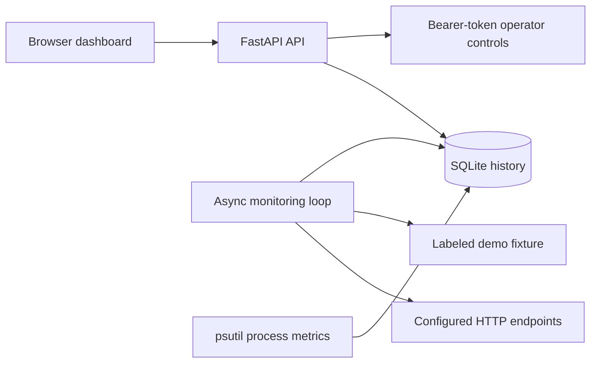

# Willow

[Live dashboard](https://willow-42d3.onrender.com) · [CI validation](https://github.com/Kisukii/willow/actions/runs/40348850368)

A small infrastructure health dashboard with a soft parchment, sage and wine-red interface. Built with Python, FastAPI, SQLite and plain JavaScript.

## Features

- Concurrent real HTTP probes every 15 seconds, with response times and actionable errors.
- Healthy (2xx), degraded (over 1 second), unavailable (other HTTP statuses or network failures) and pending states.
- Incident and recovery events stored in SQLite; bounded history of 2,000 rows per table.
- Actual application process CPU and RSS memory, labeled separately from the demo endpoint.
- Responsive dashboard, status filtering, incident log and token-protected operator controls.
- Deliberate demo failure injection and recovery; no claimed cloud account integration.
- Non-root Docker image, Compose persistent volume, CI tests and container smoke test.

## Architecture



The default live target is Willow's own health endpoint. The Inventory API is a local demo fixture, probed with real HTTP requests. No independent cloud services are connected by default. Resource charts describe Willow's process, not monitored remote services. Startup events describe monitor lifecycle; there is no deployment event integration.

## Local setup

Python 3.12 recommended. From the repository root:

```powershell
python -m venv .venv
.\.venv\Scripts\python.exe -m pip install -r requirements-dev.txt
$env:PORT = "8001"
$env:ADMIN_TOKEN = "choose-a-long-random-private-value"
.\.venv\Scripts\python.exe -m uvicorn app.main:app --host 127.0.0.1 --port 8001 --workers 1
```

Visit http://127.0.0.1:8001. Set the same PORT used by uvicorn so self-probes reach the correct port. Use one worker because the monitoring loop and demo state are process-local. Native startup does not load .env automatically.

### Docker

Install Docker, copy `.env.example` to `.env`, set a private random ADMIN_TOKEN, then:

```sh
docker compose up --build -d
docker compose logs -f
docker compose down
```

Visit http://127.0.0.1:8000. The named volume preserves history. `docker compose down -v` deletes that history. The historical filename `infrawatch.db` is retained to preserve existing local data after the product rename.

## Demo walkthrough

1. Wait for both endpoints to become healthy.
2. Open Configuration and enter your ADMIN_TOKEN.
3. Click Inject demo failure; Inventory API should return 503 and record an incident.
4. Click Recover demo service; a recovery event should appear.
5. Open Resources and Incident log. Tokens remain in page memory only.

Public visitors can read the dashboard but cannot change demo state without the operator token. Keep the token private; reviewers can view the read-only dashboard.

## Configuration

| Variable | Default | Purpose |
| --- | --- | --- |
| PORT | 8000 | Server and self-probe port |
| SELF_URL | loopback URL using PORT | Override self-probe origin |
| ADMIN_TOKEN | unset | Operator token; controls disabled when unset |
| CHECK_INTERVAL | 15 | Seconds between completed cycles; minimum 5 |
| DATABASE_PATH | data/infrawatch.db | SQLite location |
| DEMO_ENABLED | true | Enable demo fixture and controls |
| MONITOR_TARGETS | built-in targets | JSON array of id, name, url and kind |

Example MONITOR_TARGETS: `[{"id":"api","name":"My API","url":"https://your-service.example/health","kind":"live"}]`.

Targets are trusted operator configuration. Use only endpoints you are authorized to monitor. Each request has a 4-second timeout; TLS verification is enabled and redirects are not followed. Do not place credentials or secret URLs in targets: endpoint URLs are visible on the public dashboard.

## Tests and CI/CD

```sh
python -m pytest -q
node --check app/static/app.js
```

Local validation on October 26, 2026: 11 tests passed; JavaScript syntax passed; real HTTP failure and recovery were exercised. Tests cover auth, disabled controls, classification, HTTP/network errors, history persistence and demo transitions. Docker build and container health smoke test also passed in GitHub Actions. Public HTTPS homepage and /health returned 200; the hosted dashboard API returned measured samples. Browser visual QA remains incomplete because browser automation was blocked.

GitHub Actions runs tests, checks JavaScript, then builds and smoke-tests the container. The supplied Render Blueprint deploys updates only after CI checks pass. The current service was created through the Render integration with automatic deployment disabled; deploy future updates manually after CI passes. Initial deployment still requires a Render account and repository connection. An optional hook job is disabled unless DEPLOY_ENABLED=true and RENDER_DEPLOY_HOOK is configured; do not enable it alongside Render auto-deploys.

## Public deployment

See [deployment guide](docs/DEPLOYMENT.md). The live dashboard is https://willow-42d3.onrender.com.

## Security and limitations

- Public read access exposes monitored endpoint names, URLs, status and errors; configure only non-sensitive targets.
- Operator controls require an environment token. Use HTTPS in production. No user accounts, role management, distributed locking or rate limiting.
- CPU is process CPU normalized to logical host cores; it is not a container quota or cloud utilization measurement. The first CPU sample may be zero.
- History is bounded and chart windows contain actual observed samples, not uptime guarantees. State comparisons reset on process restart; persisted events remain.
- Free hosting is an internship demo, not a production alerting or always-on monitoring service. No notifications, billing integration or remote container metrics are implemented.
- Deployment and CI files are provided; GitHub tests, Docker build and container smoke test passed on October 26, 2026.

## Screenshots

Open the overview after several checks, capture the browser with Windows Snipping Tool, then capture the incident log after a failure/recovery demonstration. Avoid exposing the operator token or sensitive endpoint URLs. Save images in docs/ and link them here for your application.

## Learn next

Docker networking and volumes; HTTP/DNS/TLS troubleshooting; CI checks and secrets; monitoring metrics and incident response; cloud persistence, security and cost controls.
